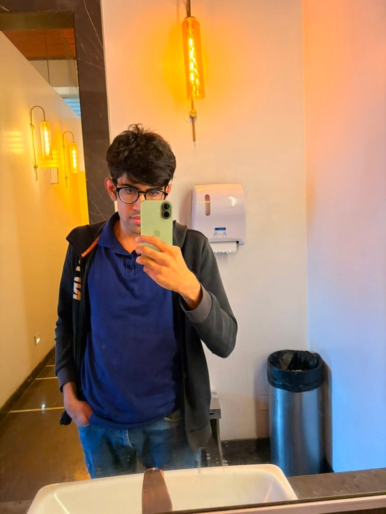
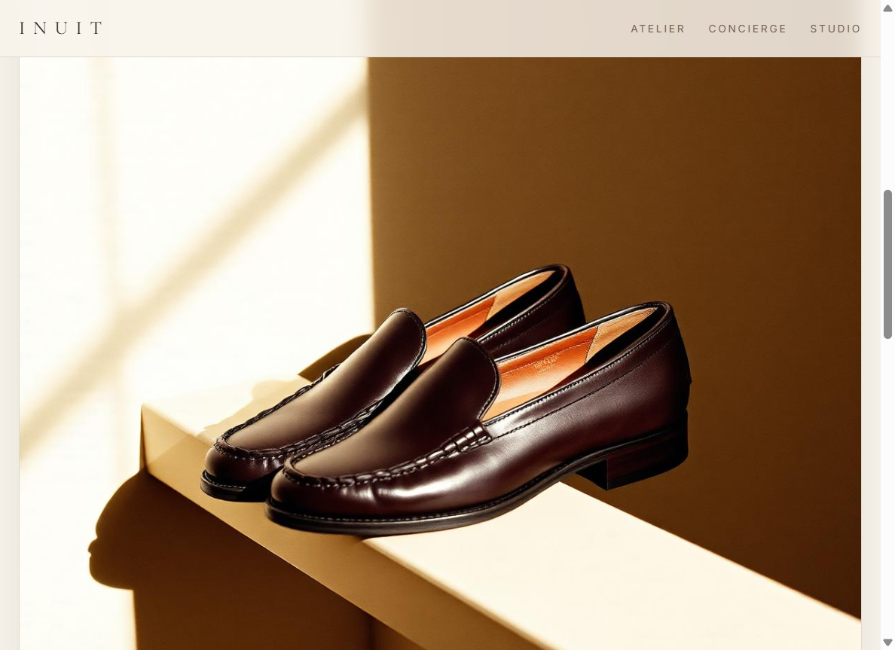

<!-- ============================================================
  Tejas Melkote — Profile README
  Visual-first · contribution-forward · hire-ready
============================================================ -->

  

  

  
  
  
  
  

 

<table>
<tr>
<td width="28%" align="center" valign="top">
  
    
  
</td>
<td width="72%" valign="top">

### I ship AI that has to survive production.

Final-year **B.Tech CS (AI)** at MIT Manipal. This year I merged into a live product at **SuperAGI**, shipped a construction platform at **TatvaOps**, and co-authored a poster at **Sci-FM @ COLM 2026**.

A model that never ships is just a very expensive CSV.

| Signal | Proof |
| --- | --- |
| **2,606+** GitHub contributions | Combined `@Tejasdagr8` + `@TejasMelkote` · shipping phase |
| **15+** production PRs | SuperAGI · Go · Rails · Vue · Jenkins · ArgoCD |
| **Live** products in market | [Vantage](https://vantage.withtatva.ai/) · [TasteIQ](https://devtasteiq.withtatva.ai/) · [INUIT](https://inuitfootware.vercel.app/) |
| **COLM 2026** accepted poster | [arXiv:2602.21947](https://arxiv.org/abs/2602.21947) · 15.9% calibrated coverage |

</td>
</tr>
</table>

  

## ⚡ The number that matters — **2,606+ contributions**

  

Not tutorial commits. Not semester dumps. A **shipping-year** across personal + work accounts — agents, production features, CMS surfaces, and research code.

  
  

  
  

  <b>@TejasMelkote</b> · work &nbsp;|&nbsp; <b>@Tejasdagr8</b> · personal &nbsp;|&nbsp; +500 commits on private production repos

  

<b>Why this number is a hiring signal</b>

 

- **Volume with intent** — campaign tooling, CMS, SEO, analytics, agent workflows, research runs  
- **Two identities, one shipping phase** — personal experiments + work product in the same year  
- **CI/CD muscle memory** — Jenkins, ArgoCD, Vercel, Docker — not just notebooks  

  

## 🖥 Portfolio — the UI hiring managers remember

  
   
  Live portfolio · dark UI · case studies · terminal · recruiter packet → <a href="https://tejas-melkote.vercel.app/">tejas-melkote.vercel.app</a>

  

## 🚀 Products I've shipped (click any image)

### 01 · Vantage — live construction intelligence

**[vantage.withtatva.ai](https://vantage.withtatva.ai/)** — CMS + community + AI for real estate & construction in India.  
I owned vendor profiles, editorial SEO, analytics, and AI modules on **React + Vercel** — serving real users, not a demo reel.

`React` `TypeScript` `CMS` `SEO` `Analytics` `Vercel` `AI content`

---

### 02 · TasteIQ — swipe → Design DNA → match

**[devtasteiq.withtatva.ai](https://devtasteiq.withtatva.ai/)** — Interior decisions stall on words like *"modern."*  
TasteIQ learns taste from **swipes**, keeps a living taste graph, and matches homeowners to vendors whose craft already fits. One graph. Three surfaces.

`Taste Graph` `Swipe UX` `React` `AI matching` `TatvaOps`

---

### 03 · INUIT — luxury footwear, ordered by conversation

<table>
<tr>
<td width="48%">
  
</td>
<td width="52%">
  
</td>
</tr>
</table>

**[inuitfootware.vercel.app](https://inuitfootware.vercel.app/)** — Small-batch leather storefront where the **concierge is the checkout**.  
Fit, style, and order happen in one conversation — and the page still reads like a brand, not a support widget.

`Conversational commerce` `Next.js` `Vercel` `Brand UI` `AI concierge`

---

### 04 · Agents & multimodal systems

<table>
<tr>
<td width="50%" valign="top">

#### AI Trip Planner
LangGraph agent over **FastAPI**, Dockerized, orchestrating **7 APIs**.  
Weather, search, and places are a state machine — a failed tool call is a step you can see, not a dead itinerary.

[→ GitHub](https://github.com/TejasMelkote/AI_Trip_Planner)

`LangGraph` `FastAPI` `Docker` `Agents`

</td>
<td width="50%" valign="top">

#### Medical Image Analyzer
One Streamlit surface for **vision + PDF summaries + RAG Q&A**, with auth around the session.

[→ Live app](https://medimage.streamlit.app/)

`Streamlit` `Vision` `RAG` `Auth`

</td>
</tr>
</table>

  

## 🧠 Research that separates the resume

> **Large Language Models are Algorithmically Blind**  
> Sci-FM @ **COLM 2026** accepted poster · [arXiv:2602.21947](https://arxiv.org/abs/2602.21947)

8 frontier models · 13 datasets · **5,200+** algorithm runs.  
Calibrated coverage: **15.9%**. Predicted ranges ran far wider than a real confidence interval — and still missed the true mean.

With Sohan Venkatesh & Ashish Mahendran Kurapath.

  

  

## 💼 Experience recruiters can verify in 30 seconds

<table>
<tr>
<td width="33%" valign="top">

### SuperAGI
**SDE Intern** · Jan–May 2026

Email & WhatsApp campaign features in a production codebase.

**15+ PRs** shipped via Jenkins + ArgoCD.

`Go` `Rails` `Vue` `Sidekiq` `Redis` `Kafka`

</td>
<td width="33%" valign="top">

### TatvaOps
**Full-Stack / AI** · May 2026–present

Building **Vantage** — knowledge platform already serving users.

Vendor profiles · SEO · analytics · Eva AI.

`React` `CMS` `Vercel` `AI`

</td>
<td width="34%" valign="top">

### CirrusLabs
**AI/ML Intern** · 2025

LLM chatbots, agents, ML pipelines packaged for the team that had to use them.

`FastAPI` `Streamlit` `LLMs` `Agents`

</td>
</tr>
</table>

### How I work

I start from the **action a user takes**, then the data, then the model.  
Agents get **explicit state**. A demo and a production deploy are different jobs — and I've done both.

  

## 🛠 Stack I reach for

  

  <code>Python</code> · <code>Go</code> · <code>TypeScript</code> · <code>React</code> · <code>Rails</code> · <code>Vue</code> · <code>FastAPI</code> · <code>LangGraph</code> · <code>PyTorch</code> 
  <code>Jenkins</code> · <code>ArgoCD</code> · <code>Redis</code> · <code>Kafka</code> · <code>Docker</code> · <code>Vercel</code>

  

## 🎓 School

**B.Tech Computer Science (AI)** · Manipal Institute of Technology · 2022–2026 · **CGPA 8.38**  
Class Representative, AI-C · PR Head, E-Cell · Operations Head, College Fest

  

## 📩 If you're hiring — make this the easiest yes

I want a team where **models meet users**, latency budgets are real, and shipping is the culture.

<table>
<tr>
<td align="center" width="25%">
  <a href="https://tejas-melkote.vercel.app/"><b>Portfolio</b></a> 
  case studies + UI
</td>
<td align="center" width="25%">
  <a href="https://tejas-melkote.vercel.app/resume.pdf"><b>Resume</b></a> 
  one-pager PDF
</td>
<td align="center" width="25%">
  <a href="https://arxiv.org/abs/2602.21947"><b>Paper</b></a> 
  COLM 2026
</td>
<td align="center" width="25%">
  <a href="mailto:coooltejasdagr@gmail.com"><b>Email</b></a> 
  coooltejasdagr@gmail.com
</td>
</tr>
</table>

  

---

  

  ✦ Built for humans who hire builders · Bengaluru · Open to AI/ML & Software Engineering roles ✦

