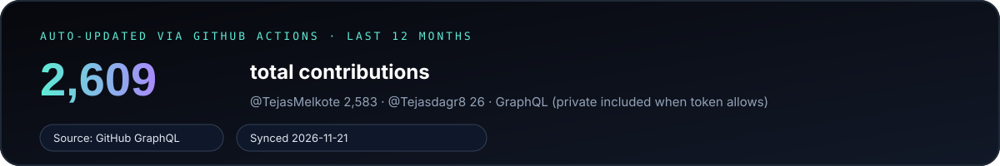
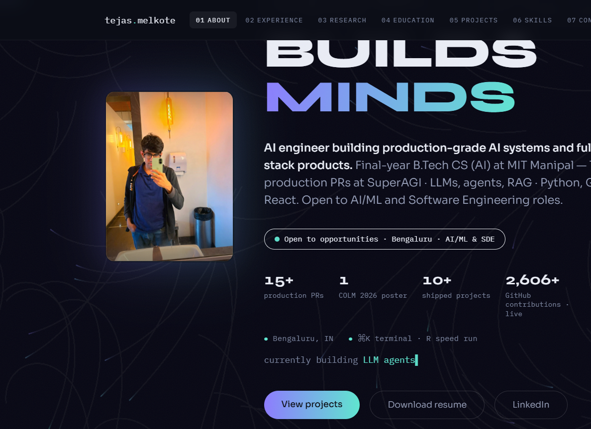
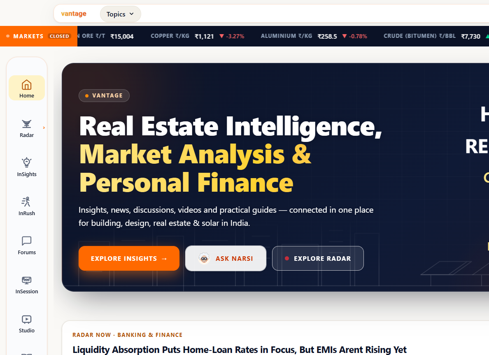
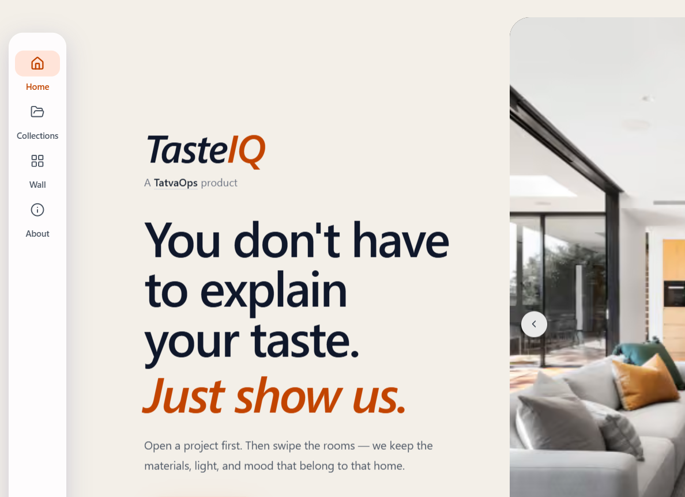

<!-- Profile README — numbers from GitHub GraphQL (verified). Case studies: tejas-melkote.vercel.app -->

  

  
  
  
  
  

  <a href="https://github.com/TejasMelkote"><code>@TejasMelkote</code></a> · work
  &nbsp;·&nbsp;
  <a href="https://github.com/Tejasdagr8"><code>@Tejasdagr8</code></a> · personal
  &nbsp;·&nbsp;
  <a href="https://tejas-melkote.vercel.app/">portfolio</a>

### I ship AI that has to survive production.

**2026 new grad** — **B.Tech CS (AI)** at MIT Manipal. This year I shipped production work at **SuperAGI** and **TatvaOps**, and co-authored a poster at **Sci-FM @ COLM 2026**.

Full case studies, live demos, and the contribution pulse live on my [portfolio](https://tejas-melkote.vercel.app/).

| | |
| --- | --- |
| **GitHub (last 12 months)** | **2,609** contributions — `2,583` on [@TejasMelkote](https://github.com/TejasMelkote) + `26` on [@Tejasdagr8](https://github.com/Tejasdagr8) (GitHub GraphQL) |
| **SuperAGI** | SDE intern · Email & WhatsApp campaign features · **15+** production PRs · Go, Rails, Vue, Jenkins, ArgoCD |
| **TatvaOps** | Full-stack / AI · [Vantage](https://vantage.withtatva.ai/) + [TasteIQ](https://devtasteiq.withtatva.ai/) in production |
| **Research** | [arXiv:2602.21947](https://arxiv.org/abs/2602.21947) · Sci-FM @ COLM 2026 · 15.9% calibrated coverage |

  

## Contributions (verified)

  

These totals come from GitHub’s contribution calendar API for each account (includes private activity visible to the authenticated `@TejasMelkote` session). No third-party “stats card” estimates.

| Account | Role | Contributions (12 mo) |
| --- | --- | ---: |
| [@TejasMelkote](https://github.com/TejasMelkote) | work | 2,583 |
| [@Tejasdagr8](https://github.com/Tejasdagr8) | personal | 26 |
| **Combined** | | **2,609** |

Live breakdown (same numbers, UI) → [portfolio GitHub pulse](https://tejas-melkote.vercel.app/)

  

## Portfolio

  

  <a href="https://tejas-melkote.vercel.app/">tejas-melkote.vercel.app</a>
  · case studies · resume · recruiter packet

  

## Shipped products

### Vantage — construction & real-estate intelligence

  

**[vantage.withtatva.ai](https://vantage.withtatva.ai/)** — Live CMS + community + AI for construction / real estate in India (TatvaOps).  
Work: vendor profiles, editorial SEO, analytics, AI modules · React + Vercel.

---

### TasteIQ — swipe → Design DNA → match

  

**[devtasteiq.withtatva.ai](https://devtasteiq.withtatva.ai/)** — TatvaOps product. Learn interior taste from swipes, keep a taste graph, match to vendors.

---

### INUIT — conversational luxury footwear

  

**[inuitfootware.vercel.app](https://inuitfootware.vercel.app/)** — Brand storefront where fit, style, and order run through an AI concierge.

---

### Agents & multimodal

- **[AI Trip Planner](https://github.com/TejasMelkote/AI_Trip_Planner)** — LangGraph + FastAPI + Docker · 7 API integrations  
- **[Medical Image Analyzer](https://medimage.streamlit.app/)** — Streamlit · vision + PDF + RAG

  

## Research

> **Large Language Models are Algorithmically Blind**  
> Sci-FM @ COLM 2026 · [arXiv:2602.21947](https://arxiv.org/abs/2602.21947)

8 frontier models · 13 datasets · 5,200+ algorithm runs · calibrated coverage **15.9%**.  
With Sohan Venkatesh & Ashish Mahendran Kurapath.

  

## Experience

| Role | Org | When | Notes |
| --- | --- | --- | --- |
| SDE Intern | SuperAGI | Jan–May 2026 | Campaign features (Email / WhatsApp) · 15+ PRs · Go, Rails, Vue, Sidekiq, Redis, Kafka, Jenkins, ArgoCD |
| Full-Stack / AI | TatvaOps | May 2026–present | Vantage + TasteIQ · React, CMS, SEO, analytics, AI |
| AI/ML Intern | CirrusLabs | 2025 | LLM agents & ML pipelines · FastAPI, Streamlit |

How I work

I start from the user action, then the data, then the model. Agents get explicit state. Demos and production deploys are different jobs — I’ve done both.

  

## Stack

  

`Python` · `Go` · `TypeScript` · `React` · `Rails` · `Vue` · `FastAPI` · `LangGraph` · `PyTorch` · `Jenkins` · `ArgoCD` · `Redis` · `Kafka` · `Docker` · `Vercel`

  

## School

**B.Tech Computer Science (AI)** · Manipal Institute of Technology · 2022–2026 · CGPA **8.38**  
Class Representative (AI-C) · PR Head, E-Cell · Operations Head, College Fest

> A model that never ships is just a very expensive CSV.

  

## Contact

| | |
| --- | --- |
| Portfolio | [tejas-melkote.vercel.app](https://tejas-melkote.vercel.app/) |
| Resume | [PDF](https://tejas-melkote.vercel.app/resume.pdf) |
| Paper | [arXiv:2602.21947](https://arxiv.org/abs/2602.21947) |
| Email | [coooltejasdagr@gmail.com](mailto:coooltejasdagr@gmail.com) |
| LinkedIn | [tejas-melkote](https://www.linkedin.com/in/tejas-melkote-390545309/) |
| GitHub | [@TejasMelkote](https://github.com/TejasMelkote) · [@Tejasdagr8](https://github.com/Tejasdagr8) |

  2026 new grad · Bengaluru · Open to AI/ML & Software Engineering roles

