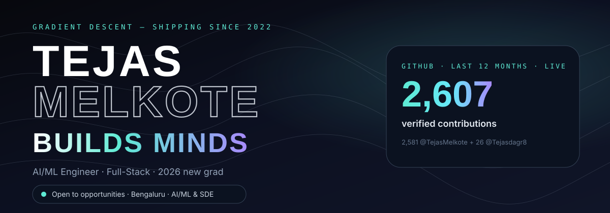
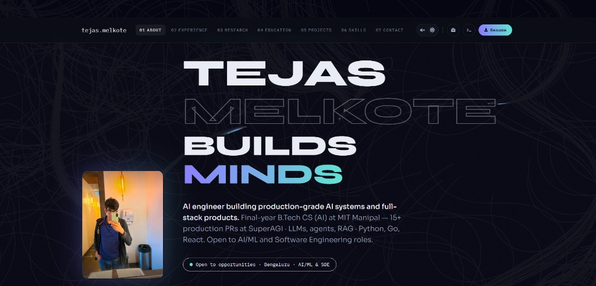
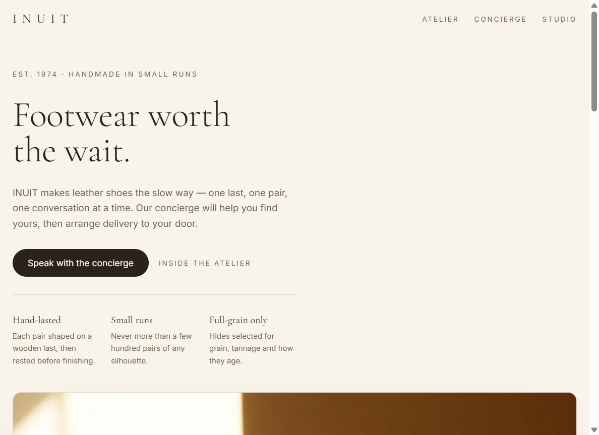

<!-- Profile README — numbers from GitHub GraphQL (verified). Case studies: tejas-melkote.vercel.app -->

  

  
  
  
  
  

  <a href="https://github.com/TejasMelkote"><code>@TejasMelkote</code></a> · work
  &nbsp;·&nbsp;
  <a href="https://github.com/Tejasdagr8"><code>@Tejasdagr8</code></a> · personal
  &nbsp;·&nbsp;
  Bengaluru · open to AI/ML &amp; SDE

### I ship AI that has to survive production.

**2026 new grad** — **B.Tech CS (AI)** at MIT Manipal (CGPA 8.38). This year I shipped production software at **SuperAGI** and **TatvaOps**, and co-authored a poster at **Sci-FM @ COLM 2026**.

Full case studies, live demos, and the contribution pulse → **[tejas-melkote.vercel.app](https://tejas-melkote.vercel.app/)**

| | |
| --- | --- |
| **GitHub (last 12 months)** | **2,635** contributions — `2,609` on [@TejasMelkote](https://github.com/TejasMelkote) + `26` on [@Tejasdagr8](https://github.com/Tejasdagr8) (GitHub GraphQL) |
| **SuperAGI** | SDE intern · Email & WhatsApp campaign features · **15+** production PRs · Go, Rails, Vue, Jenkins, ArgoCD |
| **TatvaOps** | Full-stack / AI · [Vantage](https://vantage.withtatva.ai/) + [TasteIQ](https://devtasteiq.withtatva.ai/) in production |
| **Research** | [arXiv:2602.21947](https://arxiv.org/abs/2602.21947) · Sci-FM @ COLM 2026 · 15.9% calibrated coverage |

  

## Contributions (verified)

  

Totals from GitHub’s contribution calendar GraphQL API (includes private activity when the authenticated token allows). No third-party “stats card” estimates.

| Account | Role | Contributions (12 mo) |
| --- | --- | ---: |
| [@TejasMelkote](https://github.com/TejasMelkote) | work | 2,609 |
| [@Tejasdagr8](https://github.com/Tejasdagr8) | personal | 26 |
| **Combined** | | **2,635** |

Live UI → [portfolio GitHub pulse](https://tejas-melkote.vercel.app/)

  

## Portfolio

  

  <a href="https://tejas-melkote.vercel.app/">tejas-melkote.vercel.app</a>
  · case studies · resume · recruiter packet

  

## Featured work

### Production (TatvaOps)

#### Vantage — construction & real-estate intelligence

  

**[vantage.withtatva.ai](https://vantage.withtatva.ai/)** — Live CMS + community + AI for construction / real estate in India.  
My work: vendor profiles, editorial SEO, analytics, AI modules · React + Vercel.

#### TasteIQ — swipe → Design DNA → match

**[devtasteiq.withtatva.ai](https://devtasteiq.withtatva.ai/)** — Learn interior taste from swipes, keep a taste graph, match to vendors.

---

### Independent products

#### INUIT — conversational luxury footwear

  

**[inuitfootware.vercel.app](https://inuitfootware.vercel.app/)** · [`TejasMelkote/inuitfootware`](https://github.com/TejasMelkote/inuitfootware) — Brand storefront where fit, style, and order run through an AI concierge.

#### AI Trip Planner — LangGraph agents

[`TejasMelkote/AI_Trip_Planner`](https://github.com/TejasMelkote/AI_Trip_Planner) — FastAPI + LangGraph + RAG + React. Multi-agent trip planning with tool integrations and Docker deploy.

#### MedTruth AI — medical claim verification

[`Tejasdagr8/MedTruth_AI`](https://github.com/Tejasdagr8/MedTruth_AI) — RAG + LLM pipeline that verifies medical claims against retrieved evidence (tests included).

#### RAG Project — teaching retrieval stack

[`Tejasdagr8/RAG_Project`](https://github.com/Tejasdagr8/RAG_Project) — Clean FastAPI retrieval-augmented generation service for study and demos.

  

## Research

> **Large Language Models are Algorithmically Blind**  
> Sci-FM @ COLM 2026 · [arXiv:2602.21947](https://arxiv.org/abs/2602.21947)

8 frontier models · 13 datasets · 5,200+ algorithm runs · calibrated coverage **15.9%**.  
With Sohan Venkatesh & Ashish Mahendran Kurapath.

  

## Experience

| Role | Org | When | Notes |
| --- | --- | --- | --- |
| SDE Intern | SuperAGI | Jan–May 2026 | Campaign features (Email / WhatsApp) · 15+ PRs · Go, Rails, Vue, Sidekiq, Redis, Kafka, Jenkins, ArgoCD |
| Full-Stack / AI | TatvaOps | May 2026–present | Vantage + TasteIQ · React, CMS, SEO, analytics, AI |
| AI/ML Intern | CirrusLabs | 2025 | LLM agents & ML pipelines · FastAPI, Streamlit |

### How I work

Start from the user action, then the data, then the model. Agents get **explicit state**. Reliability beats demos — ship and production deploy are different jobs, and I’ve done both.

  

## Stack

| Area | Tools |
| --- | --- |
| Languages | Python · Go · TypeScript · JavaScript |
| AI / LLM | LangGraph · LangChain · PyTorch · RAG · embeddings |
| Frontend | React · Next.js · Vue · Vite |
| Backend | FastAPI · Rails · Node · Redis · Kafka |
| Infra | Docker · Jenkins · ArgoCD · Vercel · GitHub Actions |

  

  

## School

**B.Tech Computer Science (AI)** · Manipal Institute of Technology · 2022–2026 · CGPA **8.38**  
Class Representative (AI-C) · PR Head, E-Cell · Operations Head, College Fest

> A model that never ships is just a very expensive CSV.

  

## Contact

| | |
| --- | --- |
| Portfolio | [tejas-melkote.vercel.app](https://tejas-melkote.vercel.app/) |
| Resume | [PDF](https://tejas-melkote.vercel.app/resume.pdf) |
| Paper | [arXiv:2602.21947](https://arxiv.org/abs/2602.21947) |
| Email | [coooltejasdagr@gmail.com](mailto:coooltejasdagr@gmail.com) |
| LinkedIn | [tejas-melkote](https://www.linkedin.com/in/tejas-melkote-390545309/) |
| GitHub | [@TejasMelkote](https://github.com/TejasMelkote) · [@Tejasdagr8](https://github.com/Tejasdagr8) |

  2026 new grad · Bengaluru · Open to AI/ML & Software Engineering roles

